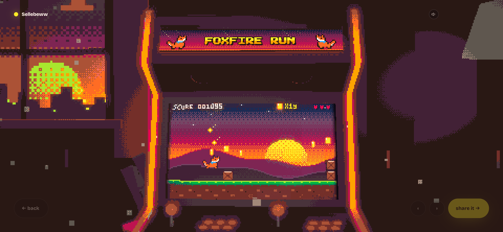

# Sellebeww Arcade



Arcade pixel-art interaktif: jawab empat pertanyaan singkat, lalu mainkan game mini buatanmu sendiri di mesin arcade 3D.

## About

Sellebeww Arcade mengubah jawaban pemain menjadi game yang bisa langsung dimainkan.

1. **Jawab 4 pertanyaan:** nama, genre, karakter utama, dan suasana (vibe).
2. **Kartu desain:** jawaban dirangkum jadi satu kartu desain game (judul, karakter, musuh, item, palet warna, mekanik).
3. **Game dibuat:** Gemini menghasilkan kode game dari kartu itu. Selama menunggu, kamu bisa main game contoh bawaan.
4. **Main di mesin arcade 3D:** marquee, panel samping, dan layar CRT mengikuti kartu desainmu.
5. **Bagikan:** simpan skor terbaik sebagai kartu gambar (PNG) untuk dibagikan.

Genre tersedia: platformer, runner, shooter, breakout, dodger, maze.

## Teknologi

React 19 + TypeScript, Vite, three.js (mesin arcade 3D), XState (alur layar), Express (server dan proxy API), Google Gemini (`@google/genai`). Game berjalan terisolasi di iframe sandbox dengan engine pixel sendiri di [engine/](engine/).

## Jalankan

Butuh Node.js 20+ dan API key Gemini.

```bash
npm install
cp .env.example .env.local   # isi GEMINI_API_KEY
npm run dev
```

Buka `http://localhost:8787` (ubah dengan `PORT=xxxx`). Tanpa API key, aplikasi tetap tampil tetapi game baru tidak bisa dibuat.

## Perintah

| Perintah | Fungsi |
|---|---|
| `npm run dev` | Server development |
| `npm run build` | Build produksi ke `dist/` |
| `npm start` | Jalankan hasil build |
| `npm run typecheck` | Cek tipe TypeScript |
| `npm run build-cart` | Bangun ulang engine game di `public/cart/` |

## Struktur

- `src/`: antarmuka React, panggung 3D (`stage/`), kartu desain (`card/`), skin mesin (`skin/`), kartu share (`share/`)
- `engine/`: engine game pixel dan 6 game contoh per genre
- `server/`: server Express dan proxy Gemini (dengan batas pemakaian per IP)
- `agent/`, `agents/`: instruksi untuk agen pembuat game
- `public/`: aset, game contoh, dan host iframe game

## Author & License

Created by Vassel Goleyu. Copyright (c) 2026 Vassel Goleyu. All rights reserved.
